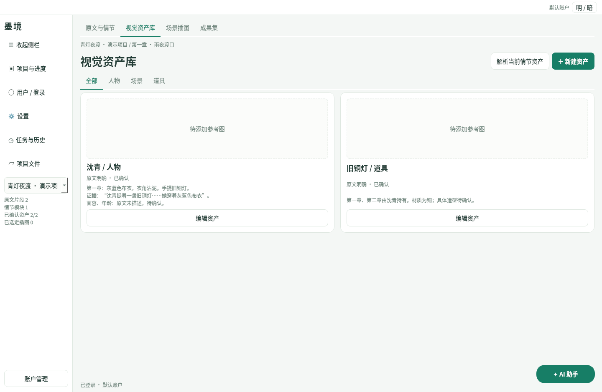

# 墨境 · 小说智能可视化系统

**v0.3.0-beta.1 测试版（预发布）· Python + PySide6 桌面程序**

> 本版本用于功能体验、流程验证和问题反馈，尚非稳定正式版。升级前请备份用户数据。当前提供源码，未提供 Windows EXE 安装包，尚未完成 Windows 实机验证。

围绕“原文片段 → 情节模块 → 共享资产 → 场景方案 → 插图”组织工作。所有 LLM 阶段可多轮讨论，也可完全手工定稿。模型调用须用户主动提交，失败不自动重试、不切换备用模型。



## 启动

建议 Windows 10/11、64 位 Python 3.10–3.13。解压到可写目录，双击 `start_windows.bat`，或手动运行：

```powershell
py -3 -m venv .venv
.venv\Scripts\python.exe -m pip install -r requirements.txt
.venv\Scripts\python.exe main.py --demo
```

启动直接进入访客工作区；实际操作时选择或创建本地账户。默认数据目录为启动目录下的 `user-data`；登录窗口可更改数据根目录，建议选择空间充足的目录。`--demo` 只在账户无项目时创建虚构示例，不发起真实 AI 调用。初次依赖安装需要联网。

```powershell
.venv\Scripts\python.exe main.py --data-root "D:\NovelData"
.venv\Scripts\python.exe main.py --choose-root
```

本次测试环境为 Linux + Qt offscreen，未在 Windows 实机验证，未提供 EXE 安装包。Linux 开发可用 `python3 -m venv .venv`，安装依赖后运行 `python main.py`。

## 从 0.1 / 0.2 升级

1. 关闭旧程序，保留用户数据目录；程序目录与数据目录分开。
2. 用当前源码替换程序文件，更新依赖，然后选择原数据根目录。
3. 首次打开 schema 1 项目，会先将旧数据库和项目元信息备份到项目的 `08_项目数据/迁移备份/`，再升级到 schema 2。
4. 原小说、资产、历史任务、确认版本和旧提示词不删除。旧文本节点的记录会关联到该片段默认情节；自定义旧提示词作为补充保留。
5. 旧统一凭据保留为“旧版文本连接”；旧节点可迁移原连接。新节点默认使用独立演示连接，需自行配置服务和密钥。不会因配置缺失自动切换真实服务。
6. 升级后的 schema 2 项目不要再用旧程序打开。如需回退，应恢复备份到独立目录。

运行时的数据备份和版本记录属于用户资料，不随源码清理删除。仓库文件只保留当前实现；历史版本说明统一记录于 [CHANGELOG.md](CHANGELOG.md)。

## 推荐试用流程

1. 启动进入访客工作区；通过左侧“用户 / 登录”选择或创建账户。“项目与进度”可切换不同小说、查看进度、新建或备份项目。
2. 在“原文与情节”逐段导入 TXT/MD/DOCX/EPUB，或粘贴原文；选择粗/中/细深度，点击“智能拆分”打开 AI 助手并提交。演示连接不联网。
3. 在助手的“方案与入库”校验、预览并确认情节；情节卡可编辑、手工拆分、合并。调整前的情节归档保留。
4. 点击情节卡“解析资产”，讨论后确认候选；在“视觉资产库”按人物、场景、道具管理档案、证据和参考图。
5. “场景插图”集中显示当前情节的候选插图和关联资产卡。缺失资产可补建或关联；生成前由用户确认是否接受缺失项。
6. 与助手多轮讨论场景方案、最终提示词，也可手工填写。图片生成后可选为正式插图，进入“成果集”并回链原情节。

主工作标签只有原文与情节、视觉资产库、场景插图、成果集；设置、历史、文件从系统侧栏打开独立标签。侧栏可收起，顶栏只显示用户名和主题切换。AI 助手默认收起，唤起后可移动、缩放；收起保留草稿及窗口位置，不挤占工作区。

## 独立连接与密钥

统一从左侧“设置”进入“语言模型配置”或“图片模型配置”。语言模型按任务节点分别设置连接、密钥、温度、最大输出 token 和提示词；图片模型独立设置连接、生成约束、ComfyUI 工作流与映射。配置可在工作过程中修改，对后续调用生效，历史快照不变。

| 类型 | 地址及用途 |
| --- | --- |
| 演示 | 不联网；用于验证交互，不代表真实解析 |
| 文本/视觉 OpenAI 兼容 | 如 `http://localhost:11434/v1`，附加 `/chat/completions` |
| ComfyUI | 如 `http://127.0.0.1:8188`，API 工作流执行 |
| 图像 OpenAI 兼容 | 基础 `/v1` 地址，附加 `/images/generations`；仅文生图 |

每个连接有独立 ID 与凭据槽，按账户隔离；可以复用连接，也可“复制为独立连接”，复制不带密钥。修改被复用的连接影响以后的调用，不改变历史快照。

密钥默认仅本次会话有效，用户可选择系统安全凭据库。后端不可用时不会回退到明文。普通设置、项目数据库、任务快照和导出不保存密钥字段，已知凭据在文本持久化/导出时脱敏。

设置导出排除所有凭据、旧凭据引用、服务地址和背景图片文件。导入连接生成全新 ID，不会复用原账户的系统密钥；用户需重新配置地址及密钥。节点模型、温度、最大输出 token 和图片输入必须符合实际服务能力，不保证任意供应商原生协议兼容。

## 提示词体系

内置通用规则与 13 个任务模板：拆分/调整拆分、综合/人物/场景/道具提取、资产设定图、场景方案、提示词定稿、生成前检查、视觉审核、局部编辑说明、全过程规划。

节点模板可编辑、另存/新增、保存为账户模板和恢复内置默认；恢复默认不删除个人模板。每次调用发送“通用规则＋当前任务模板＋输出约定＋节点补充规则＋项目规则”，记录模板版本及实际参数。

在“预览输入”查看实际提示词、原文、对话、关联资产与附件。原文按段落标号；非拆分节点只带当前情节范围，资产仅带当前情节关联项，避免每次重传整本小说。历史对话仍会累积 token，本版不自动摘要或计费估算。

结构化输出只在校验和用户确认后入库。情节 JSON 必须完整覆盖原文且不重叠；资产检查类别、证据段落和摘录。输出不合规时允许手工修正，不自动调用模型修复。新模板的结构化输出类型受当前节点约束，不支持随意变更程序字段后仍自动入库。

详情见 [提示词模板说明](docs/提示词模板说明.md)。

## 情节、资产及变化追踪

- 情节记录标题、摘要、原文段落与字符范围、原文哈希及文本快照。
- 同项目复用资产，关联通过稳定资产 ID 保存；同一情节可列出尚未建档的资产需求。
- 缺失状态区分：缺档案、设定待确认、缺参考图、参考图丢失。
- 已确认方案单独存版本。重拆分归档旧情节及编辑，不自动抹除人工内容。
- 修改情节、资产或上游确认方案后，下游标为需复核，不自动重新生成。
- 文件外部修改后可以重新读取原文；调用前若情节原文哈希失配，需先核对并保存情节。
- 用户可直接编辑项目文件；除原文重新读取外，其他外部修改尚不会自动反向同步到 SQLite，应通过界面编辑正式档案。

## 图片生成

ComfyUI：导入 **API 格式** JSON，按实际节点填写映射，例如：

```json
{
  "prompt": ["6", "text"],
  "seed": ["3", "seed"],
  "reference_1": ["12", "image"]
}
```

prompt 为必需映射。`reference_N` 按情节资产卡顺序编号（包括缺失卡位）；只上传明确映射且存在的主图。上传前可确认附件，未映射主图会明确提示不会发送。其余参数采用工作流内的值，程序不保证任意自定义节点兼容。

兼容图像 API：使用所选独立模型及密钥调用 `/images/generations`，接收 Base64 图片或 HTTPS 下载地址。当前只支持文生图，不上传资产参考图；若有参考图会提示限制，用户决定是否继续。未验证特定云端供应商。

任何生成任务保留实际提示词、连接描述、资产/情节快照及工作流。asset 卡片会列出关联信息，但图像模型实际收到的文字以用户最终提示词为准；请用输入预览及定稿阶段核对约束。

“停止等待”不保证终止服务端执行/计费。ComfyUI 不发送全局 interrupt；可按 prompt_id 查询历史。文本调用非流式，已经发出的 HTTP 请求等待响应或超时（默认 90 秒）。中断状态不会自动重新提交。

## 附件、导出与账户

- 对话框拖入文档/图片：添加本轮附件，不立即上传；原文区拖入文档：创建片段；定稿/提示词框拖入 TXT/MD：插入正文；资产编辑可拖入参考图。
- 实际发送包含附件时默认确认（包括历史附件），显示目标服务、文件及大小；纯文本默认无弹窗，可在设置调整。单附件上限 20 MB，字节数不等于 token 或费用。
- 对话、仅模型输出、最近输出、选中文字、当前最终方案可导出 TXT/MD，UTF-8 编码。
- 账户可创建、改名和删除；删除归档资料并清理应用凭据。本地账户不是操作系统访问控制。
- 支持明/暗/跟随系统、背景图片、可见度、字号和恢复外观。
- 项目可 ZIP 备份并恢复为独立项目；原始文件、过程文档、其他附件均可通过文件目录查看。
- 规划节点可在设置中留空，不影响其他阶段。当前仅提供建议，不自动调度任务。

## 文件组织

```text
数据根目录/账户/
  账户设置/  settings.json、无密钥连接定义、个人模板
  界面资源/
  项目/项目名/
    01_原始资料/  小说原文、过程文档、其他附件
    02_文本与解析/  分段正文、情节模块、已确认方案
    03_对话记录/  按片段或情节保存 MD/JSON
    04_视觉资产/  人物、场景、道具及参考图
    05_生成任务/  快照及候选图片
    06_最终成果/
    07_导出/
    08_项目数据/  schema 2 SQLite、工作区设置、迁移备份
```

## 当前限制与验证

尚未提供：真实模型兼容性保证、Windows 实机/凭据库验证、EXE、自由节点编排、自动任务调度、图像编辑 API、超分、LoRA、复杂时间线引擎、自动别名合并和外部文件实时同步。模板中的审核/编辑建议不代表程序已执行相应操作。

```powershell
.venv\Scripts\python.exe -m pip install -r requirements-dev.txt
.venv\Scripts\python.exe -m pytest -q
```

测试结果及边界见 [TEST_REPORT.md](TEST_REPORT.md)。源码仓库：https://github.com/yourwjd123/novel-visualizer 。当前源码为 0.3.0 基础测试版。仓库仅保留当前文件，版本变化见 CHANGELOG；正常 Git 提交历史保留以便追溯。
