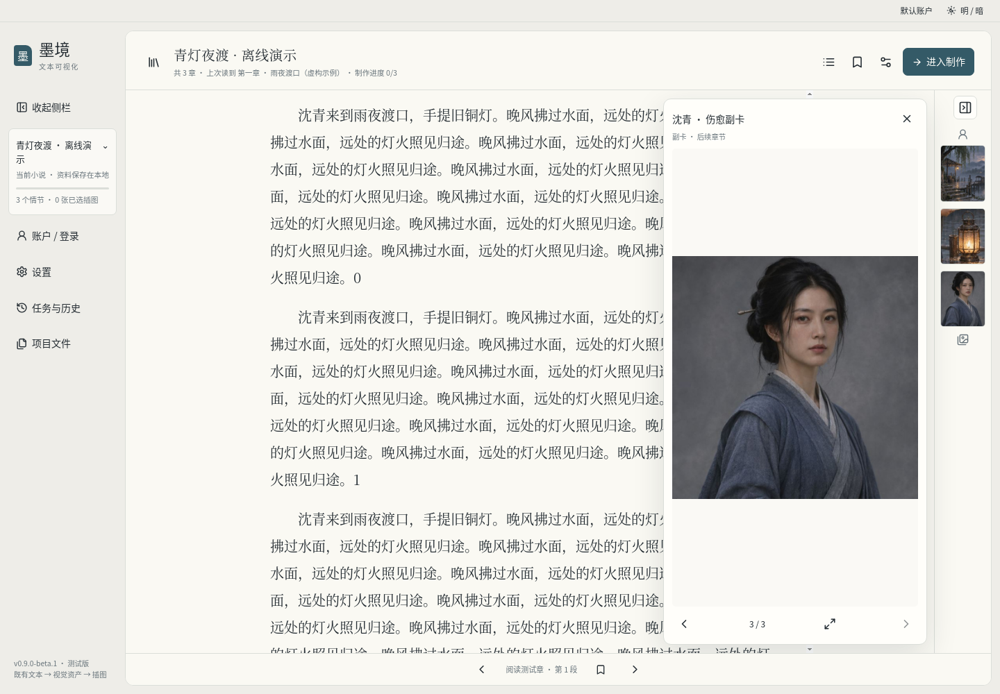

# 墨境 · 小说文本可视化

**v0.9.0-beta.1 源码测试版 · Windows 构建继续暂缓**

将用户已有文本整理成情节、视觉资产和场景插图，以卡片与画廊管理。**不包含小说创作、续写或正文改写。** 升级前请备份用户资料。



## 下载和启动

当前仓库为 v0.9.0-beta.1 测试版，含此前已编译界面；本次仅同步源码、界面资源和测试说明，不启动构建、不创建 Release。已有公开版本见 <https://github.com/yourwjd123/novel-visualizer/releases>。本轮不生成 Windows 免安装包。

- **Windows x64 测试包**：由自动构建、原生界面测试和打包后冒烟检查产出。完整解压后双击 `NovelVisualizer.exe`，保留 `_internal` 目录；无需 Python、Node.js 或 Docker。请以发布页实际附件和构建结果为准。
- **源码包**：已包含编译后的界面资源。安装 64 位 Python 3.12，双击 `start_windows.bat`，或运行下方命令；仅修改前端时需要 Node.js。

```powershell
py -3 -m venv .venv
.venv\Scripts\python.exe -m pip install -r requirements.txt
.venv\Scripts\python.exe main.py --demo
```

不需要示例项目时省略 `--demo`。示例是内置虚构文本与图片，不调用用户模型。

```powershell
.venv\Scripts\python.exe main.py --data-root "D:\NovelData"
.venv\Scripts\python.exe main.py --choose-root
```

启动直接进入书架；访客可查看入口，打开小说或制作时选择或创建本地账户。默认资料目录为系统文档目录下的“墨境用户资料”，旧数据根目录偏好继续使用。账户窗口可更改资料目录。首次安装 Python 依赖需要联网。

界面跟随系统 DPI 和显示缩放，随窗口大小重排；窄窗口收起侧栏。顶栏只显示当前用户与明暗切换。AI 浮窗可移动、缩放和收起，不挤占主工作区。

Windows 测试包未经代码签名。自动构建测试不等于所有用户机器上的实机验证。Linux 开发可用 `python3 -m venv .venv`，安装依赖后运行 `python main.py`。

## 从 0.1 / 0.2 / 0.3 升级

1. 关闭旧程序，保留用户数据目录；程序目录与数据目录分开。
2. 用当前源码替换程序文件，更新依赖，然后选择原数据根目录。
3. 首次打开 schema 1 项目，会先将旧数据库和项目元信息备份到项目的 `08_项目数据/迁移备份/`，再升级到 schema 2。
4. 原小说、资产、历史任务、确认版本和旧提示词不删除。旧文本节点的记录会关联到该片段默认情节；自定义旧提示词作为补充保留。
5. 旧连接、密钥和个人模板保留。旧版已保存的独立节点配置保留为自定义覆盖；可在“自定义节点接口”关闭覆盖，改用默认接口。新用户只需设置默认语言与生图连接。未配置时保留演示模式，不自动调用真实服务。
6. 升级后的 schema 2 项目不要再用旧程序打开。如需回退，应恢复备份到独立目录。

运行时的数据备份和版本记录属于用户资料，不随源码清理删除。仓库文件只保留当前实现；历史版本说明统一记录于 [CHANGELOG.md](CHANGELOG.md)。

## 书架与阅读

- 书架沿用现有小说项目，每张封面仅显示书名。点击后进入阅读，显示章节数量、最近位置与制作进度，可直接“进入制作”。点击侧栏品牌返回书架。
- 阅读设置支持滚动/模拟翻页、字体、字号、行距、正文宽度及纸色；可上传或恢复小说封面。章节目录、书签和最近阅读位置保存在各自项目中，阅读不修改原文。
- 右侧竖排缩略图随当前阅读范围展示关联资产与场景图片；使用图标向右收起或展开。点击图片拉起覆盖式预览，正文宽度和排版不变。资产首先展示主卡，再用箭头浏览有图片的副卡；浏览不会改变制作使用的状态。
- 场景成果优先展示，也可在阅读设置关闭候选图。图片关联沿用制作数据，并以本地名称/别名匹配补充；没有匹配时不会调用 AI 猜测。
- 成果集支持编辑标题、说明、关联情节和替换图片，以及单个/批量删除、恢复。删除是归档，原图和生成记录保留；关联到已有成果的情节前需先处理原成果。

阅读记录同时保存到 `08_项目数据/阅读记录.json`；封面位于 `01_原始资料/封面/`。成果修改记录在 `06_最终成果/编辑记录/`，删除索引为 `06_最终成果/已删除成果.json`。本轮不改变项目数据库结构，既有制作功能与侧栏保留。

## 推荐试用流程

1. 在首个“视觉资产库”标签导入章节附件或粘贴原文；“原文与情节”不再重复放置导入入口。每个附件始终一章，粘贴先确认独立建章或合并。导入后弹框显示本次与合并后章节字数，分别估算原文、建卡建议、正式建卡和拆分的输入token；本地启发式范围，不含输出/推理token，不调用模型。
2. 从阅读界面“进入制作”后，首先进入视觉资产库，点击“获取本章建卡建议”。第一轮阅读整章，仅建议主要人物、重要场景和重要道具，分级为核心/重要/建议；逐项文本展示为可编辑勾选行，不要求JSON。
3. 用户可改名、类别、等级、增加或移除建议，并可明确选择建立本章副卡。点击“为选中项建立资产卡”才发起第二轮。只为选中项建卡，优先附带本地定位的相关段落，定位不到时保留整章作为证据；不发送第一轮聊天历史。
4. 第二轮建立正式可编辑档案，内容标为待核对；相同身份不自动覆盖旧档案。有效卡片保留，失败项有原始输出与原因。单条合法证据对象可在本地规范化为数组，不调用模型修复。
5. 用户点击“完成本章资产整理”后才解锁情节解析；无图、未知外貌不阻止完成，也可明确确认无需新增资产。原文修改或重新整理建议后须重新确认。界面和后端均执行门槛。
6. 情节解析输出梗概、情节、段落范围，并默认在同次请求中关联已有资产ID，不新建资产。原文对照、编辑、拆分/合并、单卡/批量确认和撤销保留。错误关联独立标注，不丢弃有效情节，不自动重试。
7. “设置 → AI 选项”可选择AI关联（默认）、本地名称/别名匹配、仅手工关联。AI用简短身份索引理解第一人称和代词，ID在本地校验，不确定可空；本地方式无额外调用但不解析代词。人工关联和排除保留；改变拆分边界时，手工关联按原情节范围保留到重叠候选，需复核。关联不等于该图必须出镜。
8. 场景插图与资产图制作使用统一的最终生图方案编辑器；取消另行生成提示词。方案可手工编辑、AI扩写、预览实际提交正文，推测/建议/待确认内容需移出最终文本。资产按类别编辑外观、背景关系或相关情节；仅外观自动进入生图。咨询只发送前置、梗概和本轮问题，不引用历史。
9. 情节卡直接管理关联资产与副卡；关联与本图出镜分别控制。资产卡面通过状态下拉支持个别/批量确认及锁定，完成章节整理时可批量确认。图片缺失允许仅文字生成。有图资产只引用真实图片编号，不自动追加外观字段；无图资产继续使用视觉文字。有参考图时需ComfyUI映射，缺失映射先修正；普通兼容图片API仍仅文生图，只有明确接受时才改用文字描述。保留状态、用量和TXT/MD导出。

10. 两类生图工作区支持“保存生图资产到本地”，无需API：在 `09_生图素材/资产图或场景图/拟生图名称/版本_0001/` 将最终方案MD、编号参考图片、素材清单及单独说明放在同级目录，可直接打开文件夹。每次保存选择另存新版本（默认）或覆盖指定版本；覆盖只替换导出文件，用户额外文件保留。旧版描述/模板/历史保留，旧描述建议先分类整理；未修改的内置模板自动升级，个人修改不覆盖。

11. 场景插图工作区可上传或拖入外部生成的PNG/JPG/WEBP图片，先进入当前情节候选；用户确认选为成果后进入成果集。候选可移除/恢复，原图与已确认成果保留；导入图片不调用模型。
12. 道具设定图仅展示本体，不出现人物/手部/持握者；场景设定图以环境为主，允许弱化的背景人群，前景不能有突出或遮挡主体的人物。

提示词入口为“设置 → 提示词管理”，二级分类包含默认前置、节点前置、两阶段资产任务、各自动任务和补全指导；修改后保存才生效。接口地址/密钥仍在三类连接设置中维护。

## 默认接口与节点自定义

设置分为三类：①语言模型配置：一个默认 API 或本地兼容连接承担全部文本任务；②生图模型配置：一个默认图片 API 或 ComfyUI 承担资产参考图与插图；③自定义节点接口：按需为每个文本/生图节点启用独立覆盖。独立覆盖无效时明确报错，不静默回退。

各文本节点保留独立任务模板、背景提示词和补充要求，可选择继承默认温度/token 上限或单独调整。图片模型独立设置生成约束、ComfyUI 工作流与映射。配置在工作过程中修改后，对后续调用生效，历史快照不变。

| 类型 | 地址及用途 |
| --- | --- |
| 演示 | 不联网；用于验证交互，不代表真实解析 |
| 文本/视觉 OpenAI 兼容 | 如 `http://localhost:11434/v1`，附加 `/chat/completions` |
| ComfyUI | 如 `http://127.0.0.1:8188`，API 工作流执行 |
| 图像 OpenAI 兼容 | 基础 `/v1` 地址，附加 `/images/generations`；仅文生图 |

每个连接有独立 ID 与凭据槽，按账户隔离；可以复用连接，也可“复制为独立连接”，复制不带密钥。修改被复用的连接影响以后的调用，不改变历史快照。

密钥默认仅本次会话有效，用户可选择系统安全凭据库。后端不可用时不会回退到明文。普通设置、项目数据库、任务快照和导出不保存密钥字段，已知凭据在文本持久化/导出时脱敏。

设置导出排除所有凭据、旧凭据引用、服务地址和背景图片文件。导入连接生成全新 ID，不会复用原账户的系统密钥；用户需重新配置地址及密钥。节点模型、温度、最大输出 token 和图片输入必须符合实际服务能力，不保证任意供应商原生协议兼容。

## 提示词与用量

三类接口配置均可编辑用户前置提示词。默认语言与默认生图各有一份；自定义节点可继承或启用独立前置，独立前置可明确留空。文本任务在内置规则之前发送；生图在最终 prompt 首段发送或映射到工作流 prompt 节点。前置顺序不代表可以覆盖供应商自身规则。

取消项目规则编辑及发送。旧规则保留为外观页只读存档，供复制迁移；旧生成约束作为生图前置的兼容默认值，不重复追加。自动任务内置模板仍可查看、修改、新增及恢复默认；咨询不会带这些模板。固定补全指导在默认语言设置中编辑。

默认模板版本6.0，本轮不更改自动任务提示词。仅升级完全未编辑的旧内置模板，个人修改不覆盖。资产属性允许 evidence_refs 引用统一证据，减少重复摘录。第一轮阅读整章，第二轮优先附带所选对象的本地相关段落，不自动额外调用模型。

运行时显示粗略输入 token（字符估算，不含附件，不是精确 tokenizer 或价格），服务返回 usage/finish_reason 时保存实际用量与结束原因。length 不被断言为某一个具体预算；有效请求 max_tokens 可直接查看，节点覆盖仍可能不同于类别默认值。

详情见 [提示词模板说明](docs/提示词模板说明.md)。

## 情节、资产及变化追踪

- 情节记录标题、摘要、原文段落与字符范围、原文哈希及文本快照。点击卡片空白处选中；“定位原文”展开并滚动原文栏；删除后显示编号自动补齐，历史资产及图片保留。
- 资产直接从章节构建；单轮任务运行时自动显示状态，用户隐藏后不会反复弹出。模型回复与浮窗样式隔离；Esc、悬浮按钮和位置重置保留。
- 同项目复用资产，关联通过稳定资产 ID 保存；同一情节可列出尚未建档的资产需求。
- 缺失状态区分：缺档案、设定待确认、缺参考图、参考图丢失。
- 已确认方案单独存版本。重拆分归档旧情节及编辑，不自动抹除人工内容。
- 修改情节、资产或上游确认方案后，下游标为需复核，不自动重新生成。
- 文件外部修改后可以重新读取原文；调用前若情节原文哈希失配，需先核对并保存情节。
- 用户可直接编辑项目文件；除原文重新读取外，其他外部修改尚不会自动反向同步到 SQLite，应通过界面编辑正式档案。

## 图片生成

ComfyUI：导入 **API 格式** JSON，按实际节点填写映射，例如：

```json
{
  "prompt": ["6", "text"],
  "seed": ["3", "seed"],
  "reference_1": ["12", "image"]
}
```

prompt 为必需映射。`reference_N` 按情节资产卡顺序编号（包括缺失卡位）；只上传明确映射且存在的主图。上传前可确认附件，未映射主图会明确提示不会发送。其余参数采用工作流内的值，程序不保证任意自定义节点兼容。

兼容图像 API：使用所选独立模型及密钥调用 `/images/generations`，接收 Base64 图片或 HTTPS 下载地址。当前只支持文生图，不上传资产参考图；若有参考图会提示限制，用户决定是否继续。未验证特定云端供应商。

任何生成任务保留实际提示词、连接描述、资产/情节快照及工作流。asset 卡片会列出关联信息，但图像模型实际收到的文字以用户最终提示词为准；请用输入预览及定稿阶段核对约束。

“停止等待”不保证终止服务端执行/计费。ComfyUI 不发送全局 interrupt；可按 prompt_id 查询历史。文本调用非流式，已经发出的 HTTP 请求等待响应或超时（默认 90 秒）。中断状态不会自动重新提交。

## 附件、导出与账户

- 对话框拖入文档/图片：添加本轮附件，不立即上传；原文区拖入文档：创建片段；定稿/提示词框拖入 TXT/MD：插入正文；资产编辑可拖入参考图。
- 实际发送包含附件时默认确认（包括历史附件），显示目标服务、文件及大小；纯文本默认无弹窗，可在设置调整。单附件上限 20 MB，字节数不等于 token 或费用。
- 对话、仅模型输出、最近输出、选中文字、当前最终方案可导出 TXT/MD，UTF-8 编码。
- 账户可创建、改名和删除；删除归档资料并清理应用凭据。本地账户不是操作系统访问控制。
- 支持明/暗/跟随系统、背景图片、可见度、字号和恢复外观。
- 项目可 ZIP 备份并恢复为独立项目；原始文件、过程文档、其他附件均可通过文件目录查看。
- 规划节点可在设置中留空，不影响其他阶段。当前仅提供建议，不自动调度任务。

## 文件组织

```text
数据根目录/账户/
  账户设置/  settings.json、无密钥连接定义、个人模板
  界面资源/
  项目/项目名/
    01_原始资料/  小说原文、过程文档、其他附件
    02_文本与解析/  分段正文、情节模块、已确认方案
    03_对话记录/  按片段或情节保存 MD/JSON
    04_视觉资产/  人物、场景、道具及参考图
    05_生成任务/  快照及候选图片
    06_最终成果/
    07_导出/
    08_项目数据/  schema 2 SQLite、工作区设置、迁移备份
    09_生图素材/  按资产图/场景图、名称、版本保存MD和同级参考图
```

## 当前限制与验证

尚未提供：真实模型兼容性保证、Windows 实机/凭据库验证、EXE、自由节点编排、自动任务调度、图像编辑 API、超分、LoRA、复杂时间线引擎、自动别名合并和外部文件实时同步。模板中的审核/编辑建议不代表程序已执行相应操作。

```powershell
.venv\Scripts\python.exe -m pip install -r requirements-dev.txt
.venv\Scripts\python.exe -m pytest -q
```

测试结果及边界见 [TEST_REPORT.md](TEST_REPORT.md)。源码仓库：https://github.com/yourwjd123/novel-visualizer 。当前源码为 v0.5.1-beta.1 测试版。仓库仅保留当前文件，版本变化见 CHANGELOG；正常 Git 提交历史保留以便追溯。

## 开发与构建

前端使用 React，编译后通过 Qt WebEngine / QWebChannel 接入 Python 本地引擎，不启动 HTTP 服务。用户无需安装 Node.js；开发者修改前端后再执行：

```sh
npm ci --prefix frontend
npm run build --prefix frontend
python -m pip install -r requirements-dev.txt
python -m pytest -q
python tests/desktop_e2e.py
```

Windows 本机打包：`./scripts/build_windows.ps1`；GitHub Actions 自动运行同样检查，并对打包后的 EXE 截图冒烟验证。数据使用已有 schema 2；v0.1 项目在打开时先做备份迁移。

原 Qt 工作区模块暂留作兼容回归测试，默认入口已切换到新界面，不再作为第二套产品导航。

## 许可与上游

本版采用 GPL-3.0，完整条款见 [LICENSE](LICENSE)。Pagekin 的 UI/交互基础和 Story Asset Studio 的资产卡组织已适配；保留原作者归属，详情见 [THIRD_PARTY_NOTICES.md](THIRD_PARTY_NOTICES.md)。新版本不会引入小说创作流程或上游的服务端部署栈。

## 章节与状态副卡

每个原文附件始终建立一个章节，不因字数或文件内部章节标题自动拆分。粘贴录入提交后另行确认：独立章节、追加到指定上一章末尾、插入指定下一章开头。合并前正文留备份，旧情节与梗概须重新核对；章节可归档恢复，原文件和资产历史保留。原文栏提供可滚动、悬停加亮和点击切换的堆叠章节卡。

状态副卡归属同一主资产，可从资产编辑器当前内容建立、载入、更新和选择参考图。本章可手动选主卡、副卡或自动继承；单情节也可改选。自动继承仅取本章及此前有效章节最近确认副卡，不把后章状态带回前章。无图副卡默认只用文字，不自动复用旧状态图片。

生图使用有效主卡/副卡：有图仅引用参考图，无图使用视觉文字及单情节覆盖。无图不是缺失档案。ComfyUI需映射实际reference_N；兼容图片API仍仅文生图，用户明确接受后才回退文字，尚未实现通用图像编辑协议。

## 本版边界

取消资产的手动段落范围和四级分级；历史“可选择”显示为“建议”，历史任务原文不修改。整章阅读不等于提取所有提及对象。超长章节可能超过实际服务能力，本版不静默截断原文或自动追加调用。推理模式适配未新增，真实服务仍可能耗尽推理预算，不能把提示词精简视为该问题的保证修复。

候选建议识别使用简单逐项文本（名称｜类别｜等级｜理由）；无法识别时保留原文并允许手工编辑/添加，无额外模型调用。
